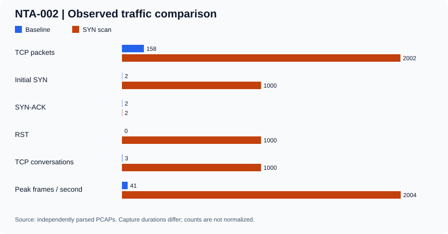
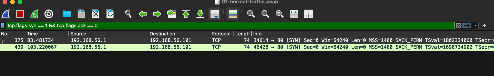
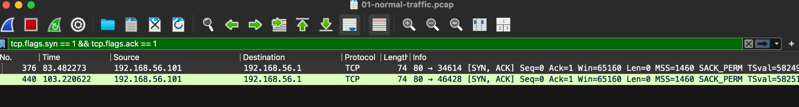
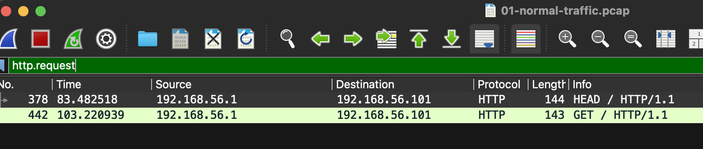
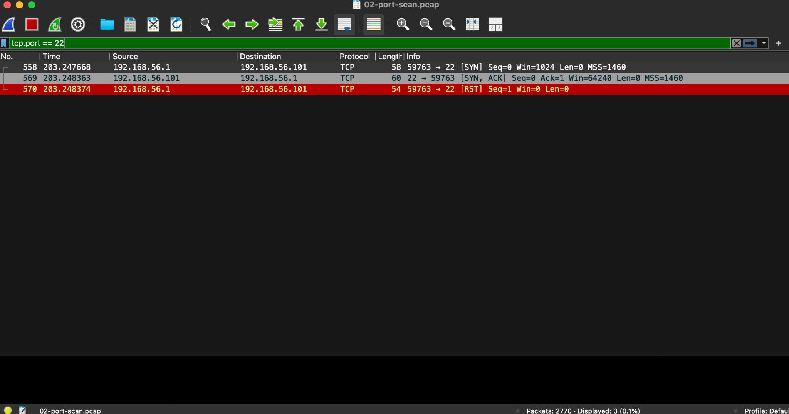
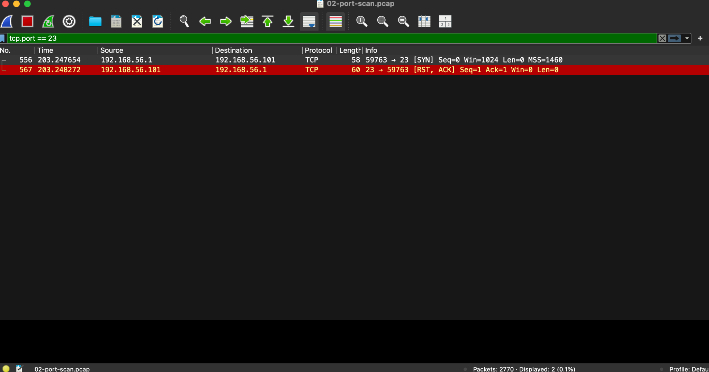
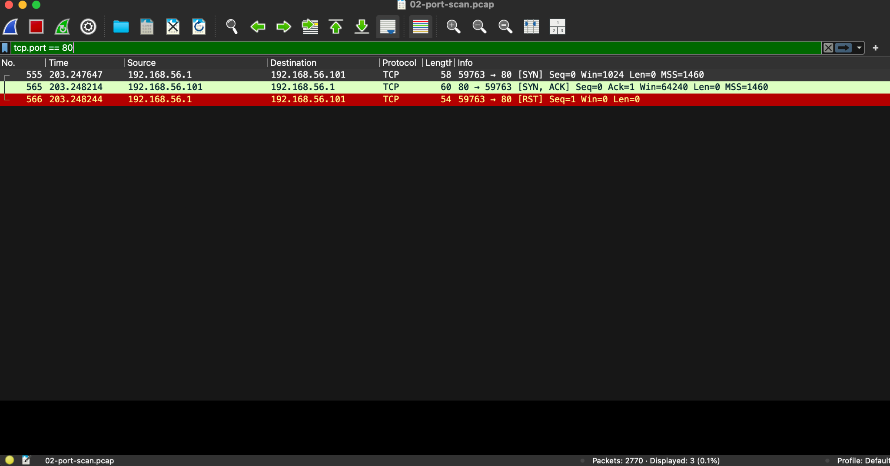
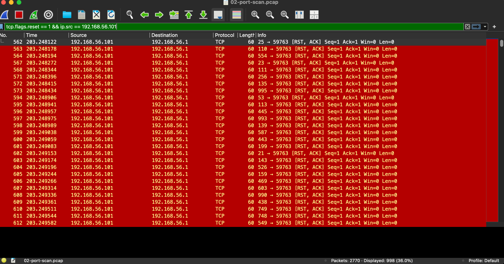
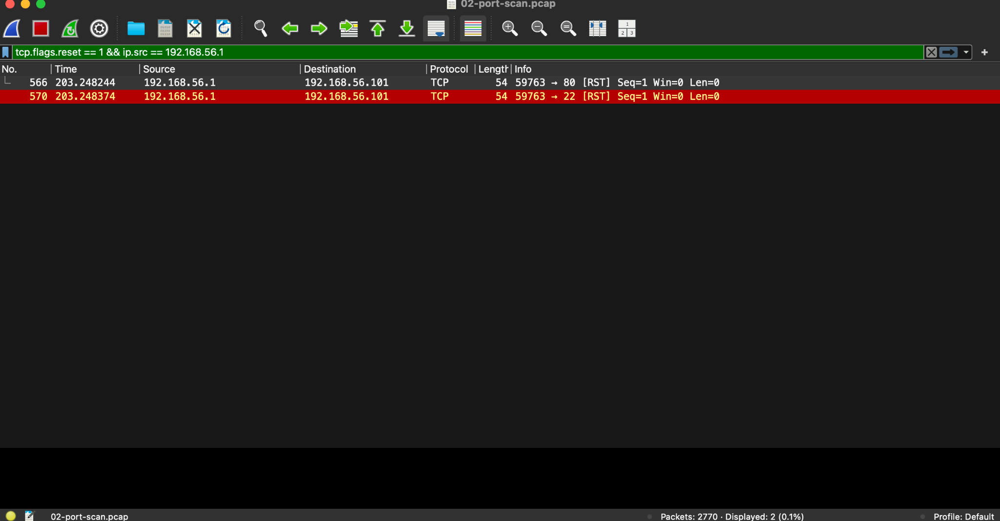
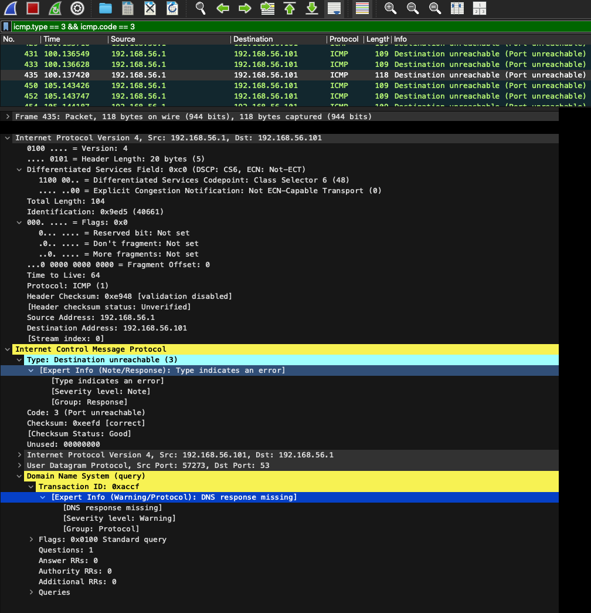

# NTA-002 | Network Traffic Analysis — TCP SYN Scan Detection

## Executive summary

This authorized, isolated laboratory compares normal network traffic with a controlled vertical TCP SYN scan. The investigation also identified an unrelated DNS configuration issue. The purpose is to demonstrate evidence-first SOC triage, network forensics, and responsible AI-assisted analysis.

## Environment and scope

- Ubuntu 24.04 host (192.168.56.1), VirtualBox host-only network, Debian 12 guest (192.168.56.101).
- Nmap 7.94SVN, tcpdump, Wireshark on a separate analysis workstation.
- Previously observed Debian listeners: TCP/22 (SSH) and TCP/80 (Apache).
- Only the isolated guest was scanned. No production systems or third-party networks were targeted.

## Methodology

1. Collect a normal-traffic baseline on the host-only interface.
2. Inspect TCP conversations, HTTP requests, DNS and ICMP errors in Wireshark.
3. Perform an authorized SYN scan of TCP ports 1–1000 using Nmap.
4. Collect the scan traffic separately, preserve hashes, compare packet patterns, and validate the AI-assisted findings manually.

Capture command: `sudo tcpdump -i vboxnet0 -nn -s 0 -w 02-port-scan.pcap`

Scan command: `sudo nmap -sS -p 1-1000 -n --reason -oN nmap-results.txt 192.168.56.101`

## Evidence integrity

SHA-256 calculated again from the original files during final review:

| Original evidence | SHA-256 |
|---|---|
| 01-normal-traffic.pcap | `6a66a398f8d0f2d1a158e7fbd5d16d5f4fb475f99b124eee9eba55a4a0ba5187` |
| 02-port-scan.pcap | `28a5d835dcf0f3610aaf8ea27933be9731bd88f374b6531618b84c48757767e5` |
| nmap-results.txt | `a7f043f71346aec3783a02d66250859d476b843b8c66535edcd4b6a6b56ec47f` |

Raw captures and the unredacted Nmap output are retained privately. The hashes are identifiers of the originals, not of redacted derivatives.

## Comparative analysis

| Metric | Baseline | SYN scan |
|---|---:|---:|
| Frames | 489 | 2,770 |
| Capture duration (s) | 115.157 | 280.437 |
| TCP packets | 158 | 2,002 |
| Initial SYN | 2 | 1,000 |
| SYN-ACK | 2 | 2 |
| RST (all) | 0 | 1,000 |
| RST from Ubuntu | 0 | 2 |
| RST from Debian | 0 | 998 |
| TCP conversations (bidirectional tuples) | 3 | 1,000 |
| Distinct destination ports in initial SYN | 1 | 1,000 |
| HTTP requests | 2 | 0 |
| ICMP destination unreachable, port unreachable | 120 | 286 |
| Peak frames in a one-second relative-time bin | 41 | 2,004 |

The final review independently parsed the original PCAP record headers, Ethernet and IPv4/TCP/ICMP fields. The HTTP requests are supported by Wireshark frames 378 (HEAD) and 442 (GET). The baseline also contains an SSH conversation already in progress when capture began: three conversations, two service ports (22 and 80), but only one distinct destination port in observed initial SYN packets. Total capture durations differ, so absolute packet volume alone is not a reliable discriminator.

## TCP evidence

| Capture | Destination port | Frames | Observed flags |
|---|---:|---|---|
| Baseline | 80 | 375, 376, 377 | SYN → SYN-ACK → ACK |
| Baseline | 80 | 439, 440, 441 | SYN → SYN-ACK → ACK |
| Scan | 22 | 558, 569, 570 | SYN → SYN-ACK → RST |
| Scan | 80 | 555, 565, 566 | SYN → SYN-ACK → RST |
| Scan | 23 | 556, 567 | SYN → RST-ACK |

Nmap reported 998 closed TCP ports and two open ports (22, 80), with no filtered ports in the tested range. Nmap execution time was 0.18 s; the first-to-last TCP packet interval in the scan capture was approximately 30.956 ms. The 2,004-frame peak occurred in the one-second bin beginning at relative second 203. These are different measurements.

The 1,000 resets comprise 998 RST-ACK packets sent by the target and two RST packets sent by the scanner after SYN-ACK responses. This explains why the reset count is not the closed-port count.

### Reproducible Wireshark display filters

- Initial attempts: `tcp.flags.syn == 1 && tcp.flags.ack == 0`
- SYN-ACK: `tcp.flags.syn == 1 && tcp.flags.ack == 1`
- Target resets: `tcp.flags.reset == 1 && ip.src == 192.168.56.101`
- Scanner resets: `tcp.flags.reset == 1 && ip.src == 192.168.56.1`
- HTTP requests: `http.request`
- ICMP port unreachable: `icmp.type == 3 && icmp.code == 3`

## Secondary finding: DNS configuration

Baseline frame 435 shows an ICMP type 3/code 3 error sent from Ubuntu to Debian, quoting the original Debian-to-Ubuntu UDP DNS query (source port 57273, destination 53, transaction ID 0xaccf). Debian's resolver configuration pointed at 192.168.56.1; the host's DNS resolver was observed listening on loopback rather than on the host-only address. This supports an operational DNS misconfiguration hypothesis, not a malicious event. NTP-related DNS queries were observed; time synchronization impact was not verified. No remediation test was conducted.

Wireshark can match fields inside quoted packets, so `dns && ip.src == 192.168.56.101 && !icmp` helps isolate actual DNS traffic from ICMP-encapsulated queries.

## Visual evidence — Wireshark

Sanitized screenshots preserve the isolated lab addresses, packet flags, frame numbers and relevant protocol fields.

### Baseline

Initial SYN packets and SYN-ACK responses:

HTTP HEAD and GET requests:

No resets observed: [all RST](evidence/baseline-no-rst.png), [Ubuntu RST](evidence/baseline-ubuntu-no-rst.png), [Debian RST](evidence/baseline-debian-no-rst.png).

### Scan

Open port 22 (SSH):

Closed port 23:

Open port 80 (HTTP):

Target resets (998) and scanner resets (2):

### DNS and ICMP

## Detection engineering proposal — DET-NET-001

Conceptual rule: count distinct destination ports in initial TCP SYN packets (SYN set, ACK unset), grouped by source and destination IP within a 10-second window. Raise an alert at 20 distinct ports. The observed scan satisfies this threshold; the baseline does not. This is a retrospective comparison, not a deployed or tested SIEM rule. The threshold is educational and requires production tuning. Authorized scanning can be a true positive for scan detection without constituting a malicious incident. A slow or distributed scan may evade this specific rule; legitimate multi-port application behavior may generate false positives.

## Simulated SOC triage

- Alert ID: SOC-2026-002 (simulation only).
- Behavior: vertical TCP SYN scan; MITRE ATT&CK T1046 (Network Service Discovery), behavioral mapping only.
- Detection disposition: True Positive — Authorized Security Activity.
- Scope: one known source, one authorized target, 1,000 TCP ports.
- No compromise established by these captures.
- Action: document and close the simulated alert; separately investigate DNS configuration.
- In an enterprise, verify asset ownership, approved scanners, change tickets, maintenance window, related logs and escalation policy before considering containment. No automatic IP blocking is justified by the scan alone.

## Human work and AI assistance

The learner built the lab, ran the tools, collected captures, inspected Wireshark evidence, answered assessments, and defended the investigation in a technical interview. AI assisted with filter selection, investigation hypotheses, quantitative cross-checks and report drafting. The learner independently checked the reset-direction finding in Wireshark (998 target resets and two scanner resets) and inspected the DNS query embedded inside ICMP, then checked Debian's resolver configuration. The final documentation also corrects the learner's distinction between conversations and destination ports, and emphasizes that authorization is separate from detection correctness.

## Limitations and lessons learned

This is a small, controlled environment and two captures, not a production baseline. Capture visibility is limited to the selected interface. There is no deployed IDS/SIEM, no measured production false-positive rate, and no proof of compromise or exploitation. The packet evidence supports recognition of a SYN scan, not attribution of malicious intent. The chart is generated from confirmed metrics; sanitized screenshots are included in the evidence directory; original images are retained privately.

## Resumo em português

Laboratório autorizado de Blue Team para identificar varreduras TCP SYN e comparar tráfego normal com reconhecimento de serviços. Foram examinadas 1.000 portas, com 22 e 80 abertas e 998 fechadas. A investigação também identificou indícios de configuração incorreta do DNS. O trabalho demonstra análise manual no Wireshark, correlação de evidências, triagem SOC e uso responsável de IA. A regra de detecção é conceitual; não foi implantada em produção.
