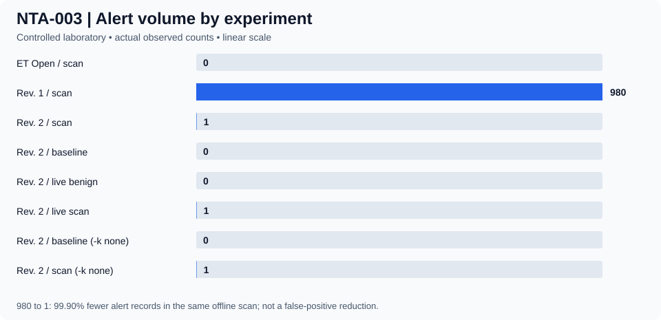

# NTA-003 | Suricata IDS — Network Detection Engineering

**Scope:** authorized, isolated Blue Team laboratory | **Dates:** November 25–26, 2026.

## Executive summary

This study extends [NTA-002](../network-traffic-analysis-002/README.md) from manual packet analysis to automated network detection. Suricata initially produced no alerts for the known internal TCP SYN scan with the installed ET Open rules. A custom signature produced 980 alerts on the same capture; tuning reduced the output to one alert (99.90% fewer alert records), while retaining detection in the tested offline and live scenarios. The tuned signature generated no alerts on the tested benign traffic.

This is a controlled experiment, not a claim of production detection accuracy.

## Environment

- Ubuntu 24.04 x86_64 host, VirtualBox host-only interface `vboxnet0`, 192.168.56.1/24.
- Debian 12 guest, 192.168.56.101, SSH and Apache.
- Suricata 7.0.3, jq 1.7, Nmap 7.94SVN, Wireshark and tcpdump.
- Passive IDS mode; `HOME_NET: "[192.168.56.0/24]"`.
- All scans restricted to the authorized guest. No real-world targets or exploitation.

## Troubleshooting and sensor validation

The systemd service initially restarted repeatedly. The journal and Suricata's internal log identified an AF_PACKET capture interface that did not exist (`eth0`); a separate warning identified missing rules. The correct configuration section was changed from eth0 to vboxnet0. Editing a similarly named interface in another YAML section did not resolve the issue.

Commands used:
```bash
sudo journalctl -u suricata -n 60 --no-pager
sudo tail -n 60 /var/log/suricata/suricata.log
grep -A 8 '^af-packet:' /etc/suricata/suricata.yaml
sudo suricata-update
sudo suricata -T -c /etc/suricata/suricata.yaml
sudo systemctl restart suricata
sudo suricatasc -c iface-list
sudo suricatasc -c "iface-stat vboxnet0"
```

The installation reported 53,541 rules loaded successfully and zero rule failures (53,546 signatures processed). The service responded with the correct interface; capture counters increased from 10,483 to 10,661 during a legitimate HTTP/ICMP test interval (178 additional packets, including possible background traffic), with zero recorded drops and invalid checksums in those counter samples.

## Telemetry investigation

The learner queried EVE JSON using jq, extracted HTTP and DNS fields, counted event types and checked for alerts. One snapshot contained 8,178 DNS, 3,492 flow, 635 stats, 2 HTTP and 1 SSH events, no alerts (12,308 total). Events are not equivalent to packets or incidents.

HTTP HEAD requests to the Debian web server returned 200 OK. Repeated NTP-related DNS queries from Debian to the Ubuntu host on UDP/53 were consistent with the earlier DNS finding in NTA-002. A server date discrepancy was also observed; the cause and impact on NTP synchronization were not verified.

- `fast.log`: concise alert records.
- `eve.json`: structured alerts and other telemetry.
- `stats.log`: sensor processing and performance counters.
- `suricata.log`: engine lifecycle and diagnostic messages.

See [jq queries](queries.md).

## Evidence integrity

The two PCAPs were reused from NTA-002. SHA-256 values were checked against the earlier report and independently recomputed from the copies supplied to the assistant:

| Capture | SHA-256 |
|---|---|
| 01-normal-traffic.pcap | `6a66a398f8d0f2d1a158e7fbd5d16d5f4fb475f99b124eee9eba55a4a0ba5187` |
| 02-port-scan.pcap | `28a5d835dcf0f3610aaf8ea27933be9731bd88f374b6531618b84c48757767e5` |

Raw PCAPs and full logs are not published. They are retained privately. The terminal output and screenshots are learner-provided evidence; the assistant did not independently execute Suricata.

## Detection development

The clean ET Open offline scan run processed 2,770 packets and 191,648 bytes without a recorded alert. The initial offline log directory had received a second interrupted run; the clean rerun was used for the final comparison. The exact reason for the ET Open coverage gap was not established.

Two custom rule revisions were tested separately with `-S`, not combined:
- [Revision 1](rules/local.rules): `detection_filter:track by_src,count 20,seconds 10`. Alerts on matching SYN packets after the threshold is exceeded.
- [Revision 2](rules/local-tuned.rules): `threshold:type both,track by_src,count 20,seconds 10`. Limits alert emission to one per source per threshold window after the count is reached.

Both use SID 1000001 and inspect internal TCP SYNs without requiring an established connection. Revision 2 is a packet-frequency approximation of the distinct-port detection concept in NTA-002; it does not count unique ports or group by both source and destination.

## Reproduction

Use separate output directories for each run; existing log files may contain previous events. Stop the live service temporarily if necessary to conserve resources. Run one revision at a time.

```bash
sudo suricata -T -c /etc/suricata/suricata.yaml -S "$LAB/rules/local-tuned.rules"
OUT=$(mktemp -d "$LAB/logs/tuned-scan.XXXXXX")
sudo suricata -r "$LAB/captures/02-port-scan.pcap" \
  -c /etc/suricata/suricata.yaml -S "$LAB/rules/local-tuned.rules" \
  -l "$OUT" --runmode single
sudo wc -l "$OUT/fast.log"
```

Set LAB to the private local laboratory directory before running. For the baseline substitute the baseline PCAP; for the ET Open run omit -S. For the live test use `--af-packet=vboxnet0` instead of -r, with a separate output directory and the standard service stopped. Generate only authorized lab traffic. Restore the standard service after testing.

## Experimental results

| Test | Alerts |
|---|---:|
| ET Open — scan, clean rerun | 0 |
| Rev. 1 — offline scan | 980 |
| Rev. 2 — offline scan | 1 |
| Rev. 2 — offline baseline | 0 |
| Rev. 2 — live benign HTTP/ICMP test | 0 |
| Rev. 2 — live SYN scan | 1 |
| Rev. 2 — offline baseline, checksum validation disabled | 0 |
| Rev. 2 — offline scan, checksum validation disabled | 1 |



The baseline contains 489 packets and 46,751 bytes. Suricata warned of invalid checksums during baseline processing. A complementary offline-only run using `-k none` did not change the results on either capture. Checksum offloading is a possible explanation, not a confirmed root cause. The live sensor's checksum configuration was not changed.

## Alert-to-packet correlation

| Field | Offline rev. 2 | Live rev. 2 |
|---|---|---|
| Timestamp (UTC-03) | 2026-11-25 16:34:52.876186 | 2026-11-26 23:13:24.339172 |
| Source | 192.168.56.1:59763 | 192.168.56.1:53666 |
| Destination | 192.168.56.101:143 | 192.168.56.101:23 |
| SID / revision | 1000001 / 2 | 1000001 / 2 |
| Severity | 2 | 2 |
| Action | allowed | allowed |
| PCAP frame | 583 | not recorded as a PCAP frame |

The learner matched EVE's `pcap_cnt:583` and timestamp to Wireshark frame 583. Independent parsing of the supplied scan capture confirmed that frame 583 is a 58-byte Ethernet frame carrying a TCP SYN from 192.168.56.1:59763 to 192.168.56.101:143, with the matching timestamp. The port associated with the alert is the port on the packet that triggered the threshold; it is not proof that this port is open or compromised.

The live scan reported 998 closed and two open ports (22 and 80). The live sensor recorded 2,292 packets, zero drops and zero invalid checksums on shutdown. The virtual interface reported unsupported SIOCETHTOOL operations, which did not prevent this test. The learner confirmed restoration of the standard Suricata service; the custom rule was not permanently deployed.

## SOC disposition

True Positive — Authorized Security Activity in this laboratory. The signature category is Attempted Information Leak; it is a rule classification, not evidence of exfiltration. Behavior maps to MITRE ATT&CK T1046 (Network Service Discovery). No compromise was established. In a real organization, validate the source and target, inspect packet and endpoint evidence, check authorized scanner inventory and change tickets, document the scope, and escalate according to the playbook and authority. Do not block solely because an IDS alert was generated.

## Limitations

- Packet counts are not distinct port counts; repeated SYNs to one port or multiple targets can trigger this rule. Slow or distributed scans may not trigger it.
- Thresholding reduces repetitive alert emission, not necessarily false positives. It can suppress separate activity within the same source window.
- Eight test conditions on two original captures and one controlled live scan cannot establish production precision, recall or generalizability.
- The live test used the custom rule exclusively, not the full ET Open rule set simultaneously.
- The root causes of the checksum warning and clock discrepancy remain unconfirmed.
- Five original screenshots were sanitized with opaque redactions of personal host/user identifiers, home-directory prefixes and MAC/raw byte areas. The sanitized PNG package is prepared separately; binary upload to this repository is pending.

## Human work and AI assistance

The learner installed and configured the IDS, ran diagnostic commands, collected and queried logs, executed the rule validation and offline/live experiments, and manually correlated an alert with the original Wireshark frame. AI provided procedural guidance, drafted the rule and tuning variants, suggested hypotheses and queries, reviewed evidence and assisted with documentation. The learner explained the concepts in a final assessment and targeted reassessment (9.2/10 on the six-question reassessment). This is a learning assessment, not an accredited certification.

## Resumo em português

Laboratório de IDS e engenharia de detecção com Suricata. Uma varredura interna conhecida não gerou alertas com o conjunto de regras instalado. Uma assinatura personalizada gerou 980 alertas; após tuning, gerou apenas um, mantendo a detecção no teste offline e em tempo real. O tráfego legítimo testado não acionou a assinatura. A redução de 99,90% refere-se ao volume de alertas repetitivos, não a falsos positivos. O estudo documenta troubleshooting, consultas JSON, validação humana e limitações da regra.
